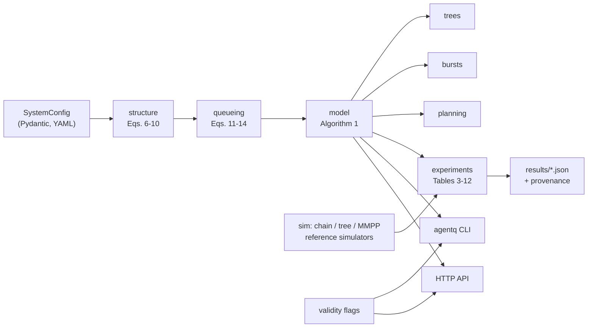

# agentq

**Queueing and branching-process performance models for multi-agent LLM workflows.**
Predict latency percentiles, success probability and cost per successful task from a workflow's *structure*: depth, tool fan-out, retries and sub-agent delegation, running on shared LLM and tool pools.

 

> **Research status.** This repository implements the paper *Queueing and Branching-Process Models of Multi-Agent LLM Workflows* (`paper/main.tex`). Its predictions were validated **against a simulator only**, with **assumed** parameters. They have never been calibrated or tested on real agent traces. Treat outputs as optimistic estimates at moderate load. See [Limitations](#limitations).

---

## Contents

- [Why](#why)
- [What the model does](#what-the-model-does)
- [Key contributions (from the paper)](#key-contributions-from-the-paper)
- [Architecture](#architecture)
- [Repository structure](#repository-structure)
- [Installation](#installation)
- [Quick start](#quick-start)
- [Smoke test](#smoke-test)
- [Training (calibration)](#training-calibration)
- [Evaluation and paper experiments](#evaluation-and-paper-experiments)
- [Inference](#inference)
- [Configuration](#configuration)
- [Datasets](#datasets)
- [Reproducibility](#reproducibility)
- [Limitations](#limitations)
- [Citation](#citation)
- [License](#license)

## Why

Operators of LLM agent systems must answer capacity questions:

- How many LLM replicas keep p99 below a target?
- What does widening tool fan-out cost in tail latency?
- How many retries can a workflow afford?

In agent systems the load on the endpoints is generated by the workflow itself: every task spawns many calls, failures spawn more, and parallel tool calls add synchronization delay. Utilization rules of thumb ignore all three.

## What the model does

Given a task arrival rate λ and a system configuration, the model returns:

- mean, p50, p95 and p99 latency of successful tasks;
- success probability;
- LLM calls per task and per successful task;
- pool utilizations, the stability limit and the bottleneck pool.

A system configuration consists of:

- geometric steps with mean n̄;
- fixed or Poisson tool fan-out;
- failure probability p with R retries;
- optional Poisson(m) delegation to sub-agents;
- an LLM pool and a tool pool, each with k servers and lognormal service times.

| Mechanism | Tool | Paper |
|---|---|---|
| Spawning of calls and sub-agents | Galton–Watson branching | Eqs. (1)-(5), (20)-(23) |
| Failures and bounded retries | Absorbing chain, closed forms | Eqs. (6)-(8) |
| Contention on shared pools | G/G/k: Erlang-C + two-moment wait | Eqs. (9)-(14) |
| Parallel tool calls joined | Fork-join via the fan-out PGF | Eq. (15) |
| End-to-end distribution | FFT convolutions on a grid | Eqs. (16)-(19), Algorithm 1 |
| Bursty arrivals | Poisson / quasi-static bracket | Eqs. (24)-(26) |
| Capacity for a p99 SLO | Bisection with derating δ | Eq. (27) |

## Key contributions (from the paper)

These are **reported in the paper**; see [Reproducibility](#reproducibility) for what was re-run here.

- **Accuracy:** with ρ_L ≤ 0.8, predicted mean, p95 and p99 are within 2.3%, 4.6% and 9.6% of simulation, and success probability within 0.2 percentage points.
- **Cost:** calls per successful task equal **n̄ / (1 − p), independent of the retry budget R**.
- **Where the model is inaccurate:**
  - p99 is underestimated by up to 32% at ρ_L = 0.9;
  - for a tool-bound wide fork, errors reach −21.6% (mean) and −39.6% (p99);
  - under bursty MMPP arrivals the Poisson model is off by more than 2×.
- **Bursty arrivals:** a Poisson / quasi-static bracket contained the simulated latency in all 12 tested settings.
- **Capacity planning:** a validation-derived margin (δ = 0.85) met a p99 target on average. It admitted 13–26% more load than a ρ = 0.7 rule.

## Architecture



Details: [docs/architecture.md](docs/architecture.md). Paper-to-code traceability: [docs/paper_implementation_mapping.md](docs/paper_implementation_mapping.md).

## Repository structure

```text
.
├── src/agentq/
│   ├── config.py          # typed configs, YAML loading
│   ├── grid.py            # time grid, FFT convolution, quantiles
│   ├── structure.py       # Eqs. 6-10: retries, cost, loads, stability limit
│   ├── queueing.py        # Eqs. 11-14: Erlang-C, two-moment wait, response pmf
│   ├── model.py           # Algorithm 1 (+ ablation switches, mean-value baseline)
│   ├── trees.py           # Eqs. 20-23: sub-agent tree fixed point
│   ├── bursts.py          # Eqs. 24-26: MMPP, quasi-static bracket
│   ├── planning.py        # Eq. 27: SLO capacity search
│   ├── branching.py       # Eqs. 1-5: Galton-Watson results
│   ├── validity.py        # flags for regimes where the paper found large errors
│   ├── calibration.py     # parameter estimators (tested on synthetic data only)
│   ├── sim/               # discrete-event reference simulators
│   ├── experiments/       # paper experiments, runner, comparison with paper outputs
│   ├── api/app.py         # Starlette HTTP API
│   └── cli.py             # `agentq` command
├── configs/
│   ├── profiles.yaml      # P1, P2, P3, TREE (paper Table 2)
│   └── experiments.yaml   # full (paper protocol) and smoke settings per experiment
├── results/
│   ├── paper_reported/    # raw outputs behind the paper's tables (reference)
│   └── full/              # outputs reproduced locally by this repository
├── tests/{unit,integration,smoke}/
├── scripts/smoke_test.py
├── docs/                  # architecture, setup, training, evaluation, inference, ...
├── paper/                 # main.tex + references.bib (unmodified copies)
├── IMPLEMENTATION_STATUS.md
└── SMOKE_TEST_REPORT.md
```

## Installation

```bash
python3 -m venv .venv && source .venv/bin/activate
pip install -e ".[api,dev]"        # core: numpy, scipy, pydantic, pyyaml
```

CPU only. Full instructions, including offline installs: [docs/setup.md](docs/setup.md).

## Quick start

```bash
agentq predict --profile P3 --rho 0.8            # latency percentiles, P_s, cost, bottleneck, flags
agentq capacity --profile P3 --p99-target 150    # max task rate with delta = 0.85
agentq simulate --profile P3 --rho 0.8 --tasks 30000 --seed 0
```

```python
from agentq import load_profiles, predict, rate_for_llm_utilization

p3 = load_profiles("configs/profiles.yaml")["P3"]
pred = predict(p3, rate_for_llm_utilization(p3, 0.8))
print(pred.mean, pred.p99, pred.success_prob, pred.calls_per_success)
```

## Smoke test

```bash
make smoke      # python scripts/smoke_test.py: every component once, ~5 s
make test       # 53 unit, integration and smoke tests, ~10 s
```

## Training (calibration)

There is **no training**: the model is analytical and has no weights or checkpoints. The analogue is *calibrating* its parameters from execution traces: p, n̄, the fan-out law, service distributions via MLE + AIC, and delegation m with its uncertainty. The estimators are in `agentq.calibration` and are tested on synthetic traces only. See [docs/training.md](docs/training.md).

## Evaluation and paper experiments

Every table and figure in the paper's results has an experiment with a `full` mode (the paper's protocol) and a `smoke` mode:

```bash
agentq run load_sweep --mode smoke     # seconds
agentq run load_sweep --mode full      # paper protocol
agentq compare load_sweep              # value-by-value vs results/paper_reported/
agentq run all --mode full             # everything (roughly 10-15 min on 2 vCPUs)
```

Experiments:

- **Chains:** `branching`, `retries_cost`, `fork_join`, `load_sweep`, `bottleneck`, `ablation`, `cv_sensitivity`, `depth_sweep`, `runtime`.
- **Trees:** `trees`.
- **Bursts:** `burst_failure`, `burst_bracket`.
- **Planning:** `capacity`.

Metrics, baselines and output format: [docs/evaluation.md](docs/evaluation.md).

## Inference

CLI, Python API and HTTP API (`agentq serve`, endpoints `/health`, `/profiles`, `/predict`, `/predict/tree`, `/capacity`, `/bracket`) are covered in [docs/inference.md](docs/inference.md). Container deployment: [docs/deployment.md](docs/deployment.md).

## Configuration

- `configs/profiles.yaml`: named systems. Fields map to the paper's symbols; see the `agentq.config` docstring.
- `configs/experiments.yaml`: per-experiment `full` and `smoke` parameters (grid, seeds, run lengths, sweeps). No research-critical constant is hard-coded in the experiment functions.
- `.env.example`: API settings (`AGENTQ_PROFILES`, `AGENTQ_MAX_GRID_POINTS`). No secrets are used.

## Datasets

**There are none.** The paper uses assumed parameters (Table 2) and a simulator; it collected no traces. This repository does not include or fabricate any. `agentq.calibration.synthetic_trace` produces clearly labelled *synthetic* data for testing estimators only.

## Reproducibility

- **Model predictions:** reproduce the paper's stored outputs to floating-point round-off.
- **Simulators:** seeded simulator outputs are **bit-identical** to the paper's (same draw order). This held under NumPy 2.5.3, although the paper used 2.4.4.
- **Pinning:** both properties are pinned by regression tests.
- **Per-experiment status:** see [SMOKE_TEST_REPORT.md](SMOKE_TEST_REPORT.md).
- **Procedure:** see [docs/reproducibility.md](docs/reproducibility.md).

Three kinds of numbers appear in this repository and are kept apart:

| Label | Meaning | Location |
|---|---|---|
| Reported in the paper | Paper's tables / raw outputs | `paper/`, `results/paper_reported/` |
| Reproduced locally | Full-mode runs on the build machine | `results/full/` |
| Demonstrated by smoke test | Tiny runs proving the pipeline executes | `results/smoke/` (git-ignored) |

## Limitations

- **No real-world validation.** All validation is model vs. simulator, and the simulator shares the model's workflow assumptions (geometric steps, independent failures).
- **Optimistic tails.** p99 is underestimated near saturation and in tool-bound fan-out regimes. Use derating and heed validity flags.
- **Unmodeled effects:** load-dependent retries and metastable overload, batching inside LLM servers, heterogeneous tool pools, correlated sibling arrivals, and Hawkes-type burstiness.
- **Service-time assumptions.** Measured tool tails (cited in the paper) are much heavier than the lognormal with CV 1.5 used here, and the model's error changes sign as variability grows.
- **API.** Built on Starlette because FastAPI could not be installed in the build environment. It has no authentication.

The full list, including deliberate deviations from the paper's code, is in [docs/assumptions.md](docs/assumptions.md) and [IMPLEMENTATION_STATUS.md](IMPLEMENTATION_STATUS.md).

## Citation

See [CITATION.cff](CITATION.cff). Please cite the paper (authors and venue to be completed by the paper's authors) and this repository.

## License

MIT. See [LICENSE](LICENSE).
