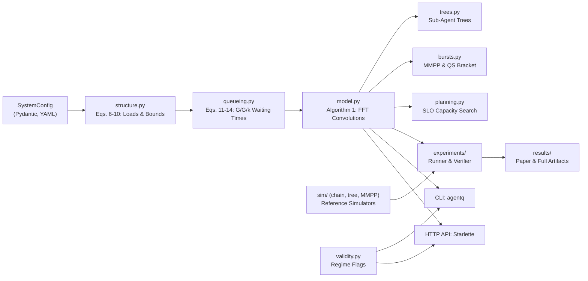

# agentq

**Queueing and branching-process performance models for multi-agent LLM workflows.**  
Predict latency percentiles, failure probability, and execution cost from workflow structure running on shared LLM and tool pools.

[](https://github.com/Himanshu3122/Queueing-and-Branching-Process-Models-of-Multi-Agent-LLM-Workflows/actions/workflows/ci.yml)
[](https://www.python.org/downloads/)
[](LICENSE)
[](https://github.com/astral-sh/ruff)
[](pyproject.toml)

> [!WARNING]
> **Research Status & Validation Notice**  
> This repository provides the reference implementation of the research paper *Queueing and Branching-Process Models of Multi-Agent LLM Workflows* (`paper/main.tex`). All predictions were validated **exclusively against a discrete-event simulator** under **assumed** architectural parameters. The models have not been calibrated or tested against production traces from real LLM agent deployments. Outputs should be interpreted as optimistic estimates at moderate workloads ($\rho_L \le 0.8$). See [Limitations & Validity Boundaries](#limitations--validity-boundaries).

---

## Contents

- [Motivation](#motivation)
- [Theoretical Foundations & Core Mechanisms](#theoretical-foundations--core-mechanisms)
- [Benchmark System Profiles](#benchmark-system-profiles)
- [Key Contributions & Reported Findings](#key-contributions--reported-findings)
- [System Architecture](#system-architecture)
- [Repository Structure](#repository-structure)
- [Installation & Environment Setup](#installation--environment-setup)
- [Quick Start](#quick-start)
  - [Command-Line Interface (CLI)](#command-line-interface-cli)
  - [Python API](#python-api)
- [Verification & Smoke Testing](#verification--smoke-testing)
- [Experimental Evaluation & Paper Reproduction](#experimental-evaluation--paper-reproduction)
  - [Experiment Suite](#experiment-suite)
  - [Reproduction Workflow](#reproduction-workflow)
  - [Data Provenance & Result Tiers](#data-provenance--result-tiers)
- [Model Calibration (Trace Estimation)](#model-calibration-trace-estimation)
- [Production Serving & Containerization](#production-serving--containerization)
  - [HTTP REST API](#http-rest-api)
  - [Docker Container](#docker-container)
- [Configuration Reference](#configuration-reference)
- [Limitations & Validity Boundaries](#limitations--validity-boundaries)
- [Troubleshooting](#troubleshooting)
- [Development Workflow](#development-workflow)
- [Citation](#citation)
- [Contributing & License](#contributing--license)

---

## Motivation

System operators deploying multi-agent LLM systems routinely face sizing and service-level objective (SLO) challenges:

- **Replication scale:** How many LLM instances are required to guarantee a 99th-percentile (p99) latency target under a given task arrival rate?
- **Fan-out overhead:** What tail latency penalty is incurred when an agent branches to multiple concurrent tool invocations?
- **Retry affordability:** How many retries can a workflow afford before cascading retries destabilize upstream shared endpoints?

In multi-agent systems, endpoint load is generated *endogenously* by the structure of the workflow: each root task generates a cascade of dependent LLM calls, step failures trigger retries that amplify downstream traffic, and parallel tool dispatches induce fork-join synchronization barriers. Conventional capacity rules of thumb (such as static $\rho = 0.7$ utilization targets or naive $M/M/k$ models) neglect all three phenomena, leading to tail misestimation and premature saturation.

---

## Theoretical Foundations & Core Mechanisms

Given an external task arrival rate $\lambda$ and a formal workflow specification, `agentq` computes:

- **Latency distributions:** Mean, p50, p95, and p99 latency of successful tasks.
- **Reliability:** End-to-end task success probability ($P_s$).
- **Resource cost:** Mean LLM calls executed per task and per *successful* task ($C_s$).
- **Capacity bounds:** Server pool utilizations ($\rho_L, \rho_T$), the system stability limit ($\lambda^*$), and the bottleneck pool.

| Mechanism | Analytical Tool | Paper Formulation | Implementation Module |
|---|---|---|---|
| **Spawning of calls & sub-agents** | Galton–Watson branching processes | Eqs. (1)–(5), (20)–(23) | [`agentq.branching`](src/agentq/branching.py), [`agentq.trees`](src/agentq/trees.py) |
| **Failures & bounded retries** | Absorbing Markov chain, closed forms | Eqs. (6)–(8) | [`agentq.structure`](src/agentq/structure.py) |
| **Contention on shared pools** | $G/G/k$ approximation: Erlang-C + two-moment wait | Eqs. (9)–(14) | [`agentq.queueing`](src/agentq/queueing.py) |
| **Parallel tool join synchronization** | Fork-join via fan-out PGF | Eq. (15) | [`agentq.model._join_pmf`](src/agentq/model.py) |
| **End-to-end task latency distribution** | Fast Fourier Transform (FFT) convolutions on time grid | Eqs. (16)–(19), Algorithm 1 | [`agentq.grid`](src/agentq/grid.py), [`agentq.model`](src/agentq/model.py) |
| **Bursty task arrivals** | 2-state MMPP & quasi-static bounds | Eqs. (24)–(26) | [`agentq.bursts`](src/agentq/bursts.py) |
| **Capacity planning for p99 SLO** | Bisection search with validation derating ($\delta = 0.85$) | Eq. (27) | [`agentq.planning`](src/agentq/planning.py) |

For complete mathematical mappings from the paper equations to code symbols, see [docs/paper_implementation_mapping.md](docs/paper_implementation_mapping.md).

---

## Benchmark System Profiles

The paper defines four canonical benchmark system profiles ([configs/profiles.yaml](configs/profiles.yaml), Table 2). All configurations share default failure probability $p = 0.08$, retry limit $R = 1$, LLM service time $E[S_L] = 3.0\text{ s}$ ($CV = 0.9$), and tool service time $E[S_T] = 1.0\text{ s}$ ($CV = 1.5$):

| Profile | Architectural Archetype | Mean Steps ($\bar{n}$) | Tool Fan-Out ($K$) | LLM Pool ($k_L$) | Tool Pool ($k_T$) | Primary Bottleneck |
|---|---|:---:|:---:|:---:|:---:|:---:|
| **P1** | Deep & narrow (ReAct-like) | 8 | Poisson ($\lambda=1.0$) | 8 | 16 | LLM pool |
| **P2** | Wide & shallow (Planner-worker-like) | 4 | Fixed ($K=6$) | 8 | 32 | Tool pool (wide join) |
| **P3** | Balanced general-purpose chain | 5 | Poisson ($\lambda=2.0$) | 8 | 16 | LLM pool |
| **TREE** | Hierarchical sub-agent delegation tree | 3 | Poisson ($\lambda=2.0$) | 8 | 16 | Sub-agent recursion |

---

## Key Contributions & Reported Findings

The following empirical and theoretical properties were established in the paper (`paper/main.tex`) and verified in local replication:

- **Accuracy under moderate load:** At LLM pool utilization $\rho_L \le 0.8$, analytical predictions for mean, p95, and p99 latencies are within **2.3%, 4.6%, and 9.6%** of discrete-event simulations, with success probability within **0.2 percentage points**.
- **Cost invariance theorem:** The expected number of LLM calls per successful task equals:
  $$\mathbb{E}[C_s] = \frac{\bar{n}}{1 - p}$$
  This quantity is **strictly independent of the retry budget $R$** (Eq. 8).
- **Quantified error regimes:**
  - Tail latency is underestimated by up to **32%** near saturation ($\rho_L = 0.9$) due to exponential tail approximations and batch arrivals.
  - In tool-bound wide fork regimes (Profile P2), synchronization errors reach **$-21.6\%$** (mean) and **$-39.6\%$** (p99).
  - Under bursty MMPP arrivals, the standard Poisson arrival assumption underestimates latency by more than **$2\times$**.
- **Bursty traffic bounding:** The Poisson model and quasi-static approximation form a provable lower/upper bracket that enclosed simulated latency across all 12 tested burst parameterizations.
- **Derated capacity planning:** A validation-derived derating factor ($\delta = 0.85$) met target p99 SLOs on average while admitting **13% to 26% higher task throughput** than a static $\rho = 0.7$ heuristic.

---

## System Architecture



Comprehensive architecture documentation: [docs/architecture.md](docs/architecture.md).

---

## Repository Structure

```text
.
├── src/agentq/
│   ├── config.py             # Pydantic schemas, YAML loading, system profiles
│   ├── grid.py               # Discretized time grid, FFT circular convolution, quantiles
│   ├── structure.py          # Eqs. 6-10: retry chains, cost invariance, pool loads, stability
│   ├── queueing.py           # Eqs. 11-14: Erlang-C, Kingman/Marchal wait, response PMF
│   ├── model.py              # Algorithm 1: end-to-end task convolution, ablation baselines
│   ├── trees.py              # Eqs. 20-23: recursive sub-agent tree fixed-point solver
│   ├── bursts.py             # Eqs. 24-26: MMPP-2 arrival rates, quasi-static bracket
│   ├── planning.py           # Eq. 27: bisection capacity search for p99 SLO targets
│   ├── branching.py          # Eqs. 1-5: Galton-Watson branching, Borel tail distributions
│   ├── validity.py           # Automated diagnostic checks for invalid/inaccurate regimes
│   ├── calibration.py        # Trace parameter estimators (MLE + AIC service fitting)
│   ├── sim/                  # Heap-based discrete-event simulators (chain, tree, MMPP)
│   ├── experiments/          # Paper reproduction suite, runners, and result comparators
│   ├── api/app.py            # Starlette ASGI REST API
│   └── cli.py                # Command-line interface entry point (`agentq`)
├── configs/
│   ├── profiles.yaml         # P1, P2, P3, and TREE profile definitions (paper Table 2)
│   └── experiments.yaml      # Sweep grids, run lengths, and seeds for paper experiments
├── results/
│   ├── paper_reported/       # Ground-truth raw JSON outputs from paper publication
│   └── full/                 # Locally reproduced experimental outputs (bit-identical)
├── tests/
│   ├── unit/                 # Mathematical functions, closed-form equations, configs
│   ├── integration/          # Simulator comparisons, regression tests, API test client
│   └── smoke/                # End-to-end CLI workflow tests
├── scripts/
│   └── smoke_test.py         # Standalone 5-second end-to-end verification script
├── docs/                     # Architectural, mathematical, and deployment documentation
├── paper/                    # LaTeX source (`main.tex`) and bibliography for reference
├── pyproject.toml            # Package build configuration, dependencies, and tools
├── Makefile                  # Build, test, lint, and reproduction automation targets
├── Dockerfile                # Production container specification for Starlette API
├── CITATION.cff              # Machine-readable scholarly citation metadata
├── IMPLEMENTATION_STATUS.md  # Detailed verification status across all paper claims
└── SMOKE_TEST_REPORT.md      # Ground-truth execution report from repository build
```

---

## Installation & Environment Setup

### Requirements

- **Python:** 3.10 or newer (tested on 3.11, 3.12, 3.13; CI verifies all three).
- **Architecture:** CPU-only (no GPU or hardware accelerators required).
- **Core dependencies:** `numpy>=1.26`, `scipy>=1.11`, `pydantic>=2.5`, `pyyaml>=6.0`.

### Virtual Environment Setup

#### Linux / macOS

```bash
git clone https://github.com/Himanshu3122/Queueing-and-Branching-Process-Models-of-Multi-Agent-LLM-Workflows.git agentq
cd agentq
python3 -m venv .venv
source .venv/bin/activate
pip install --upgrade pip
```

#### Windows (PowerShell)

```powershell
git clone https://github.com/Himanshu3122/Queueing-and-Branching-Process-Models-of-Multi-Agent-LLM-Workflows.git agentq
cd agentq
python -m venv .venv
.venv\Scripts\Activate.ps1
python -m pip install --upgrade pip
```

### Dependency Installation Options

```bash
# Option 1: Core analytical model and CLI only
pip install -e .

# Option 2: Core + HTTP REST API (Starlette, Uvicorn)
pip install -e ".[api]"

# Option 3: Full development and testing environment (Core + API + Pytest + Ruff)
pip install -e ".[api,dev]"
```

*For air-gapped or private mirror environments:* see [docs/setup.md](docs/setup.md#offline-installs).

### Running Without Package Installation

The entire suite can be executed directly from the repository root by setting `PYTHONPATH=src`:

```bash
# Linux / macOS
PYTHONPATH=src python3 -m agentq --help

# Windows PowerShell
$env:PYTHONPATH="src"; python -m agentq --help
```

---

## Quick Start

### Command-Line Interface (CLI)

The `agentq` command provides analytical predictions, capacity planning, and reference simulations.

#### 1. Analytical Latency & Cost Prediction

Compute latency percentiles, reliability, cost, and bottleneck diagnostics for Profile P3 at 80% LLM pool utilization ($\rho_L = 0.8$):

```bash
agentq predict --profile P3 --rho 0.8
```

```text
               profile: P3
             task_rate: 0.3541
                  mean: 27.11
                   p50: 22.84
                   p95: 58.74
                   p99: 120
          success_prob: 0.9688
     calls_per_success: 5.435
               rho_llm: 0.8
              rho_tool: 0.4426
                stable: True
     horizon_tail_mass: 0.00014
       stability_limit: 0.4426
            bottleneck: llm
        validity_flags: 0 item(s)
```

To output machine-readable JSON:
```bash
agentq predict --profile P3 --rho 0.8 --json
```

#### 2. Derated Capacity Search for p99 SLO

Calculate the maximum sustainable task arrival rate that maintains $p99 \le 150\text{ s}$ using the paper's recommended derating margin ($\delta = 0.85$):

```bash
agentq capacity --profile P3 --p99-target 150 --derating 0.85
```

```text
               profile: P3
            target_p99: 150
              derating: 0.85
              max_rate: 0.3644
         target_margin: 0.85
       stability_limit: 0.4426
            bottleneck: llm
```

#### 3. Seeded Reference Simulation

Run the discrete-event reference simulator to cross-validate model outputs:

```bash
agentq simulate --profile P3 --rho 0.8 --tasks 30000 --seed 0
```

```text
               profile: P3
             task_rate: 0.3541
                 tasks: 30000
                  mean: 26.85
                   p50: 22.91
                   p95: 57.65
                   p99: 114.2
          success_prob: 0.9685
```

---

### Python API

```python
from agentq import load_profiles, predict, rate_for_llm_utilization
from agentq.trees import predict_tree
from agentq.bursts import MMPP2, bracket
from agentq.planning import max_rate_for_p99

# 1. Load benchmark profiles
profiles = load_profiles("configs/profiles.yaml")
p3 = profiles["P3"]

# 2. Evaluate prediction at target utilization
arrival_rate = rate_for_llm_utilization(p3, rho=0.8)
pred = predict(p3, arrival_rate)

print(f"Mean Latency:      {pred.mean:.2f} s")
print(f"p99 Tail Latency:  {pred.p99:.2f} s")
print(f"Success Prob:      {pred.success_prob:.4f}")
print(f"Cost per Success:  {pred.calls_per_success:.3f} LLM calls")

# 3. Parametric workflow modification
# Widen tool fan-out to 6 and scale LLM servers to 16
custom_workflow = p3.with_updates(**{
    "workflow.fanout": 6.0,
    "llm.servers": 16,
})
custom_pred = predict(custom_workflow, arrival_rate)
print(f"Custom System p99: {custom_pred.p99:.2f} s")

# 4. Hierarchical sub-agent tree prediction (Poisson delegation m = 0.3)
tree_pred = predict_tree(profiles["TREE"], task_rate=0.25, delegation_mean=0.3)
print(f"Sub-agent Tree p99: {tree_pred.p99:.2f} s")

# 5. Bursty traffic bounds (Poisson optimistic vs. Quasi-static pessimistic)
burst_bracket = bracket(p3, MMPP2(rate=0.2, burst_factor=4.0))
print(f"Burst Bounds: Poisson p99={burst_bracket.poisson['p99']:.1f}s, QS p99={burst_bracket.quasi_static['p99']:.1f}s")

# 6. Automated capacity sizing under derated p99 SLO
cap = max_rate_for_p99(p3, target_p99=150.0, derating=0.85)
print(f"Max Admissible Rate: {cap.max_rate:.4f} tasks/s (Bottleneck: {cap.bottleneck})")
```

Further API examples: [docs/inference.md](docs/inference.md).

---

## Verification & Smoke Testing

To verify correctness in any environment without third-party test runners:

```bash
# Fast 5-second end-to-end smoke check (tests all public modules once)
python scripts/smoke_test.py
# Or via Makefile:
make smoke
```

To run the complete automated test suite (53 unit, integration, and regression tests):

```bash
# Standard unittest discover (zero dependencies)
python -m unittest discover -s tests -t .

# If pytest is installed
pytest

# Or via Makefile:
make test
```

Expected result: `53 passed in ~9.1s`. Detailed environment audit: [SMOKE_TEST_REPORT.md](SMOKE_TEST_REPORT.md).

---

## Experimental Evaluation & Paper Reproduction

### Experiment Suite

The repository implements every experiment, table, and figure featured in the journal paper:

| Experiment Name | Paper Target | Description & Evaluated Phenomenon | Approximate Full Runtime |
|---|---|---|:---:|
| `branching` | Table 3, Fig. 4 | Total progeny, Borel distribution, extinction probability | ~1 s |
| `retries_cost` | Table 4, Fig. 5 | Verification of $C_s = \bar{n} / (1 - p)$ cost invariance | ~2 s |
| `fork_join` | Fig. 6 | Fan-out barrier latency vs. model without join synchronization | ~100 s |
| `load_sweep` | Table 5, Fig. 7 | Model vs. simulation across $\rho_L \in [0.1, 0.95]$ on P1, P2, P3 | ~135 s |
| `bottleneck` | Table 6 | High-load errors at $0.9 \lambda^*$; tool-bound vs. LLM-bound regimes | ~180 s |
| `ablation` | Table 11 | Ablations: no queueing, no fork-join, no retries, mean-value baseline | ~110 s |
| `trees` | Table 7, Fig. 8 | Recursive sub-agent tree latency fixed point vs. tree simulator | ~180 s |
| `cv_sensitivity` | Table 8 | Model sensitivity to LLM service coefficient of variation | ~90 s |
| `burst_failure` | Table 12 | Breakdown of Poisson approximation under MMPP-2 bursty arrivals | ~70 s |
| `burst_bracket` | Table 9 | Verification that Poisson and Quasi-Static bracket contains simulation | ~40 s |
| `capacity` | Table 10 | Capacity search accuracy: $\rho = 0.7$ vs. model vs. derated ($\delta = 0.85$) | ~120 s |
| `depth_sweep` | §7.9 text | Parametric sensitivity of tail latency to mean workflow depth $\bar{n}$ | ~5 s |
| `runtime` | §7.9 text | Wall-clock execution time: analytical model vs. discrete simulation | ~2 s |

Comprehensive metrics definitions and experimental setup: [docs/evaluation.md](docs/evaluation.md).

---

### Reproduction Workflow

Experiments support two operational execution modes:
- `--mode smoke`: Fast diagnostic run with minimal tasks/grid points (~2–5 seconds per experiment) to verify the pipeline.
- `--mode full`: Full statistical protocol from the paper (30,000 tasks, 10% warm-up, multi-seed Monte Carlo).

```bash
# Run a single experiment in smoke mode
agentq run load_sweep --mode smoke

# Run a single experiment under the full paper protocol
agentq run load_sweep --mode full

# Verify reproduced numbers against published raw artifacts
agentq compare load_sweep --summary
```

To reproduce all 13 experiments sequentially:

```bash
# Executes all full-mode experiments (~10-15 minutes on 2 vCPUs)
agentq run all --mode full

# Compare all full-mode results against published paper outputs
make compare
```

*Note: Seeded discrete-event simulations reproduce published raw outputs bit-for-bit when executed under NumPy 2.5.3.*

---

### Data Provenance & Result Tiers

Artifacts are categorized into three strictly segregated directories:

| Directory | Data Source & Provenance | Version Control Status |
|---|---|---|
| `results/paper_reported/` | Ground-truth raw JSON outputs from the authors' original publication runs | Tracked in Git (Read-only reference) |
| `results/full/` | Full-mode reproduction runs executed locally on this repository | Tracked in Git (Reproducible benchmark) |
| `results/smoke/` | Truncated diagnostic artifacts produced during smoke testing | Ignored in `.gitignore` |

---

## Model Calibration (Trace Estimation)

The core queueing and branching models are **fully analytical closed forms and numerical convolutions**—there are no trained parameters, neural network weights, or stochastic gradient descent checkpoints.

In practical deployment, model parameters are *calibrated* from system telemetry:
1. **Failure probability ($p$) & Depth ($\bar{n}$):** Estimated via maximum likelihood from step traces.
2. **Fan-out law:** Inferred from tool dispatch histograms (Poisson parameter $\lambda_K$ or fixed $K$).
3. **Service distributions ($S_L, S_T$):** Maximum Likelihood Estimation (MLE) combined with Akaike Information Criterion (AIC) selection across Lognormal, Exponential, and Gamma families.
4. **Sub-agent delegation ($m$):** Estimated with binomial confidence intervals.

The calibration module ([`agentq.calibration`](src/agentq/calibration.py)) provides estimators validated against synthetic traces:

```python
from agentq import load_profiles
from agentq.calibration import calibrate, synthetic_trace

# Generate synthetic task trace (for testing estimators)
p3 = load_profiles("configs/profiles.yaml")["P3"]
trace = synthetic_trace(p3, n_tasks=2000, seed=42)

# Calibrate structural model parameters
params = calibrate(trace)
print(f"Estimated Step Failure Prob p: {params.failure_prob:.4f} (True: 0.08)")
print(f"Estimated Mean Steps n_bar:    {params.mean_steps:.2f} (True: 5.0)")
print(f"Selected LLM Service Dist:     {params.llm_service.family}")
```

Trace calibration methodology: [docs/training.md](docs/training.md).

---

## Production Serving & Containerization

### HTTP REST API

The package includes a lightweight, asynchronous ASGI HTTP service built with Starlette:

```bash
# Start the HTTP server on port 8000
agentq serve --host 127.0.0.1 --port 8000
# Or via Makefile:
make serve
```

#### API Endpoints Overview

| Method | Endpoint | Request Body | Description |
|:---:|:---:|---|---|
| `GET` | `/health` | None | Service liveness probe |
| `GET` | `/profiles` | None | Returns all loaded system profiles |
| `POST` | `/predict` | `{"profile": "P3", "rho_llm": 0.8}` | Predict latency, cost, and bottleneck |
| `POST` | `/predict/tree` | `{"profile": "TREE", "task_rate": 0.2, "delegation_mean": 0.3}` | Hierarchical sub-agent tree latency |
| `POST` | `/capacity` | `{"profile": "P3", "target_p99": 150.0, "derating": 0.85}` | Max admissible arrival rate for p99 SLO |
| `POST` | `/bracket` | `{"profile": "P3", "rate": 0.2, "burst_factor": 4.0}` | MMPP arrival burst bracket |

#### Sample Requests

```bash
# Health check
curl -s http://127.0.0.1:8000/health

# Predict request
curl -s -X POST http://127.0.0.1:8000/predict \
     -H 'Content-Type: application/json' \
     -d '{"profile": "P3", "rho_llm": 0.8}'

# Capacity planning request
curl -s -X POST http://127.0.0.1:8000/capacity \
     -H 'Content-Type: application/json' \
     -d '{"profile": "P3", "target_p99": 150.0, "derating": 0.85}'
```

*Note: Requests support either a predefined `"profile"` name or an inline, fully specified `"system"` configuration object.*

---

### Docker Container

The container runs as an unprivileged user (`agentq`, UID 10001) on Python 3.12-slim:

```bash
# Build container image
docker build -t agentq:latest .
# Or via Makefile:
make docker

# Run container with mapped HTTP port
docker run -d --name agentq-api -p 8000:8000 agentq:latest

# Verify container health
curl -s http://127.0.0.1:8000/health
```

Container configuration details: [docs/deployment.md](docs/deployment.md).

---

## Configuration Reference

- **[configs/profiles.yaml](configs/profiles.yaml):** Named system profiles (P1, P2, P3, TREE). Field names map directly to symbols in the paper; see docstring in [`agentq.config`](src/agentq/config.py).
- **[configs/experiments.yaml](configs/experiments.yaml):** Experiment sweeps, simulation seeds, grid steps, and run lengths for both `full` and `smoke` reproduction modes.
- **`.env.example`:** Environment variable template:
  - `AGENTQ_PROFILES`: Filesystem path to profiles YAML configuration (default: `configs/profiles.yaml`).
  - `AGENTQ_MAX_GRID_POINTS`: Upper limit on grid points for HTTP API requests to protect server memory (default: `100000`).

---

## Limitations & Validity Boundaries

To maintain scientific integrity, operators and researchers must consider the known modeling boundaries:

1. **Simulator-Only Validation:** All empirical validation in the paper is against a discrete-event simulator sharing the model's structural assumptions (geometric step counts, independent step failures). No empirical traces from production multi-agent systems were gathered.
2. **Tail Latency Underestimation at High Load:** At utilizations $\rho_L \ge 0.85$, the model underestimates tail latency (up to 32% at $\rho_L = 0.9$). The $G/G/k$ queueing approximation assumes an exponential wait tail and neglects batch arrival correlations generated by upstream forks. Use the validation derating margin ($\delta = 0.85$) for capacity sizing.
3. **Wide Fork Synchronization Error:** For wide parallel fan-outs (Profile P2, $K \ge 6$), tool wait variance causes synchronization underestimation of up to $-39.6\%$ at p99.
4. **Unmodeled Production Phenomena:** The analytical formulation does not model:
   - Server-side continuous request batching inside LLM inference engines (e.g., vLLM / TensorRT-LLM).
   - Load-dependent step failure rates or metastable retry storms.
   - Heavy-tailed service distributions with infinite variance.
5. **Automated Diagnostic Flags:** The model automatically returns validity flags (`agentq.validity`) whenever an evaluation falls into known error regimes (e.g., `near_saturation`, `wide_fork`, `tool_bound`, `high_cv`).

Full assumptions and deviations log: [docs/assumptions.md](docs/assumptions.md) and [IMPLEMENTATION_STATUS.md](IMPLEMENTATION_STATUS.md).

---

## Troubleshooting

| Symptom | Probable Cause | Corrective Action |
|---|---|---|
| `error: profiles file not found: configs/profiles.yaml` | CLI invoked from outside the repository root | `cd` to the repository root or provide `--profiles /path/to/profiles.yaml`. |
| `ModuleNotFoundError: No module named 'agentq'` | Package not installed in the active virtual environment | Run `pip install -e .` or execute commands with `PYTHONPATH=src`. |
| `the API needs the 'api' extra` | Optional HTTP dependencies (`uvicorn`, `starlette`) missing | Install the API extra: `pip install -e ".[api]"`. |
| `stable: false`, latencies returned as `None` | Traffic rate exceeds stability threshold ($\rho_L \ge 1$ or $\rho_T \ge 1$) | Lower arrival rate or add servers. `agentq predict` outputs the bottleneck pool and stability limit. |
| `horizon_tail_mass` noticeably $> 0$` | Grid horizon is too short for the workflow's latency tail | Increase grid points (`--points 60000`) or time step (`--dt 0.05`). |
| `max_rate` equals lower search bound (`0.001`) | Requested p99 SLO is mathematically infeasible for the workflow | Workflow execution time alone exceeds SLO without queueing; reduce depth/fan-out or relax target. |
| `RuntimeError: no successful tasks after warm-up` | Simulation run too short for extreme failure rates | Increase simulation length via `--tasks 50000`. |
| `agentq compare` error: `only full-mode results are comparable` | Comparing results generated from `--mode smoke` | Re-run the experiment using `--mode full` before comparing against paper outputs. |

Additional troubleshooting procedures: [docs/troubleshooting.md](docs/troubleshooting.md).

---

## Development Workflow

### Code Quality & Formatting

The codebase enforces strict Ruff linting and formatting standards configured in [pyproject.toml](pyproject.toml):

```bash
# Check lint rules
ruff check src tests scripts

# Check code formatting
ruff format --check src tests scripts

# Automatically fix format and lint issues
make format
```

### Local Continuous Integration (CI)

The GitHub Actions pipeline ([.github/workflows/ci.yml](.github/workflows/ci.yml)) tests across Python 3.11, 3.12, and 3.13. You can run the exact verification pipeline locally:

```bash
# 1. Lint
ruff check src tests scripts && ruff format --check src tests scripts

# 2. Unit and integration tests
python -m unittest discover -s tests/unit -t .
python -m unittest discover -s tests/integration -t .

# 3. Smoke tests
python -m unittest discover -s tests/smoke -t .
python scripts/smoke_test.py
```

---

## Citation

If you use `agentq` in academic research, system designs, or performance benchmarks, please cite the research manuscript and this implementation:

```bibtex
@article{agentq2026,
  title   = {Queueing and Branching-Process Models of Multi-Agent LLM Workflows: Latency, Failure, and Cost Prediction from Workflow Structure},
  author  = {Author Name},
  journal = {Manuscript},
  year    = {2026},
  note    = {Reference implementation available at https://github.com/Himanshu3122/Queueing-and-Branching-Process-Models-of-Multi-Agent-LLM-Workflows}
}
```

Machine-readable citation metadata is available in [CITATION.cff](CITATION.cff).

---

## Contributing & License

Contributions, bug reports, and research extensions are welcome. Please consult:
- [CONTRIBUTING.md](CONTRIBUTING.md) for code submission guidelines and test standards.
- [CODE_OF_CONDUCT.md](CODE_OF_CONDUCT.md) for community standards.
- [SECURITY.md](SECURITY.md) for vulnerability disclosure protocols.

This project is licensed under the terms of the [MIT License](LICENSE).
