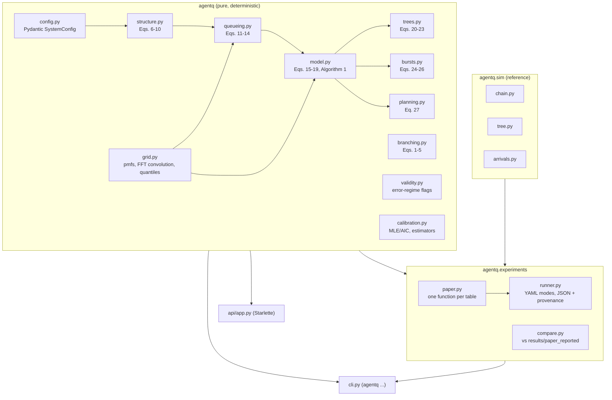
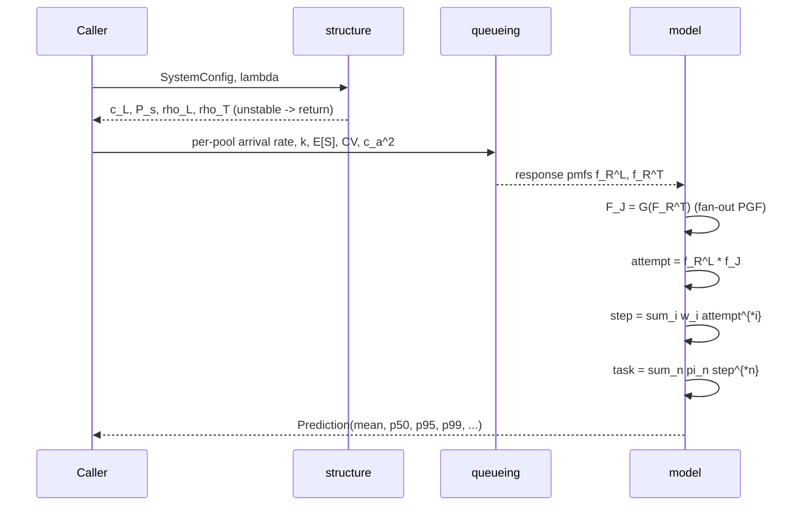

# Architecture

`agentq` is a small numerical library with a reference simulator, an experiment layer, a CLI and an optional HTTP API. There is no machine-learning model, no training loop and no database. The "model" is a closed-form plus numerical-convolution performance model (paper Algorithm 1).

## Modules

| Module | Responsibility | Paper reference |
|---|---|---|
| `grid.py` | Uniform time grid, pmf construction, FFT convolution (clip + renormalize), mean/quantiles | §5.5 discretization |
| `config.py` | `PoolConfig`, `WorkflowConfig`, `SystemConfig` (validated, immutable); YAML loading; legacy-dict adapter | §3.1, Table 2 |
| `structure.py` | `s, a, nu, P_s, c_L, C_s`; pool loads; stability limit and bottleneck | Eqs. (6)-(10) |
| `queueing.py` | Erlang-C, two-moment wait, wait/service/response pmfs | Eqs. (11)-(14) |
| `model.py` | Fork-join, retry mixture, step mixture → `Prediction`; ablation switches; mean-value baseline | Eqs. (15)-(19), Alg. 1, Table 11 |
| `trees.py` | Agents per tree, tree success, latency fixed point | Eqs. (20)-(23) |
| `bursts.py` | MMPP-2 rates, quasi-static predictor, Poisson/QS bracket, SCV | Eqs. (24)-(26) |
| `planning.py` | Bisection for max rate under a derated p99 target; server-count search | Eq. (27) |
| `branching.py` | Galton–Watson closed forms and Monte Carlo | Eqs. (1)-(5) |
| `validity.py` | Flags for regimes where the paper reports large errors | Tables 5-8, 12 |
| `calibration.py` | Estimators for p, n̄, fan-out law, service fits (AIC), delegation m; synthetic trace generator | §5.1, §9-10 |
| `sim/` | Discrete-event simulators for chains (Poisson/MMPP) and trees | §6 |
| `experiments/` | Paper experiments, runner, comparison with the paper's raw outputs | §7-8 |
| `cli.py` | `predict`, `simulate`, `capacity`, `run`, `compare`, `serve` | — |
| `api/app.py` | `/health`, `/profiles`, `/predict`, `/predict/tree`, `/capacity`, `/bracket` | — |

## Data flow of one prediction

## Design choices

- **Immutable configs.** `SystemConfig.with_updates("llm.cv", ...)` returns a validated copy, so experiments cannot mutate shared profiles.
- **Pure core.** The model does no I/O. Experiments add I/O (JSON results with environment metadata); the API adds HTTP.
- **Exact simulator port.** The simulators keep the original random-number draw order, so seeded results equal the paper's. Regression tests pin these values.
- **No hidden research constants.** Grid, seeds, run lengths, rates and parameter lists live in `configs/experiments.yaml` (`full` = paper protocol, `smoke` = tiny).
- **Validity flags rather than silent extrapolation.** The CLI and API attach flags when a configuration falls in a regime where the paper measured large errors.

## What is deliberately absent

The paper defines no model training, no datasets, no checkpoints, no agents (the agents are what is being *modeled*), and no governance mechanism beyond reporting error regimes. These are therefore absent rather than imitated. See `IMPLEMENTATION_STATUS.md`.
